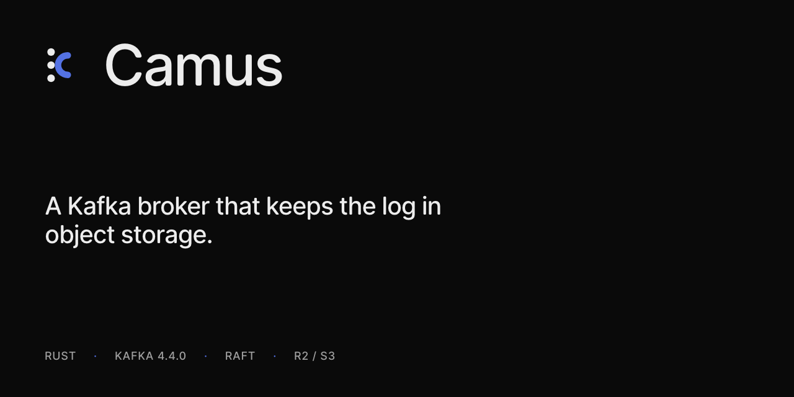

# Camus



[](LICENSE)
[](https://github.com/nidheesh-m-vakharia/camus/actions/workflows/ci.yml)
[](docs/compatibility.md)
[](rust-toolchain.toml)

Camus is a Kafka broker in one Rust binary. Producers, consumers, and admin
clients use the Kafka wire protocol. The log is stored in Cloudflare R2, or
any S3-compatible bucket. Brokers replicate metadata, and a short
write-ahead log, with Raft. A deployment does not need a JVM, ZooKeeper,
KRaft, or a separate database.

Kafka compatibility is pinned to Apache Kafka 4.4.0. The API matrix, and
the places Camus deliberately differs, are in
[docs/compatibility.md](docs/compatibility.md).

## Run one broker

Docker listens on 18001 (HTTP admin) and 9092 (Kafka PLAINTEXT), then
initializes a one-node group. Clients use `127.0.0.1:9092`.

```
docker build -t camus .
docker run --rm -p 18001:18001 -p 9092:9092 camus
```

From a checkout, the same shape is:

```
cargo run -p camus-broker -- \
  --node-id 1 \
  --http-addr 127.0.0.1:18080 \
  --kafka-addr 127.0.0.1:19092 \
  --data-dir /tmp/camus \
  --dev-plaintext
curl -sf -X POST http://127.0.0.1:18080/admin/init \
  -H 'content-type: application/json' \
  -d '[{"id":1,"addr":"127.0.0.1:18080"}]'
```

`--dev-plaintext` is refused on a non-loopback address unless you also pass
`--allow-non-loopback`. SASL_SSL needs `--tls-cert`, `--tls-key`,
`CAMUS_SASL_USER`, and `CAMUS_SASL_PASSWORD`.

The bucket defaults to MinIO at `http://127.0.0.1:9100`, bucket `camus`,
keys `camus` / `camus-dev-secret`. Override with `CAMUS_S3_ENDPOINT`,
`CAMUS_S3_BUCKET`, `CAMUS_S3_ACCESS_KEY`, and `CAMUS_S3_SECRET_KEY`. A
container does not see MinIO on the host at `127.0.0.1`; point
`CAMUS_S3_ENDPOINT` at the host.

`GET /admin/metrics` returns JSON, including `current_leader` and
`wal_leader`. `GET /metrics` is Prometheus.

Three brokers plus MinIO: `docker compose --profile brokers up`. The image
is published from `main` to `ghcr.io/<owner>/camus`, tagged `latest` and
the commit sha, after the test workflow passes. The GitHub package stays
private until you change that in the package settings.

## What clients can do

Change the bootstrap server. These clients have been run against Camus:
`kafka-clients` 4.4.0, librdkafka (confluent-kafka 2.16.1), and franz-go
v1.22.0.

- Produce and fetch, including idempotent produce. A retried sequence
  returns the original offset.
- Consumer groups: classic join, sync, heartbeat, commit, and leave, plus
  list, describe, and delete. The Java client can use
  `group.protocol=consumer` (KIP-848 `ConsumerGroupHeartbeat`).
- Transactions. `read_committed` hides a batch until `EndTxn` commits it.
  An abort stays hidden. There are no control-batch markers; visibility is
  the committed and aborted offset ranges.
- Topic admin that those libraries expose: describe cluster, describe and
  alter configs, create partitions, delete records, delete topics, and
  ACLs.
- `cleanup.policy=compact` keeps the latest record for each key, at its
  original offset. Compaction runs only when `CAMUS_COMPACT_MS` is greater
  than 0, and only over sealed extents. Tombstones are kept.

A few Kafka behaviors are different on purpose:

| | Camus |
| --- | --- |
| `acks=1` | Same barrier as `acks=all` |
| `acks=0` | No wait, and the batch may be lost |
| No ACL on a resource | Allowed. `DENY` beats `ALLOW`. Only host `*` matches |
| ACL denial on produce or fetch | `TOPIC_AUTHORIZATION_FAILED` (29) |
| `DeleteRecords` | Deletes through the next whole object, not an arbitrary offset |

The full list is in [docs/compatibility.md](docs/compatibility.md).

## Durability

| Mode | When a produce is acknowledged |
| --- | --- |
| `wal` (default) | A majority of the WAL shard has fsynced the batch. The upload to R2 follows, and the WAL is truncated. |
| `r2` | The batch is in R2 and the metadata group has committed its offsets. |

`wal` keeps a few seconds of log on local disk so acknowledgements are not
limited by object-storage latency. `r2` keeps no log bytes on the broker.
See [ADR 0005](docs/adr/0005-durability-and-acks.md).

Set the mode at topic creation with `durability.mode`. The cluster default
is `CAMUS_DEFAULT_DURABILITY`.

## Develop

```
cargo test --workspace
docker compose up -d minio create-bucket
CAMUS_MINIO=1 cargo test -p camus-storage --test minio
```

`cargo test -p camus-broker --test cluster` starts three processes, commits
a metadata write, kills the leader, and checks that a new write commits.
MinIO is built from `deploy/minio` because current community images are no
longer published. Tests that need a bucket skip unless `CAMUS_MINIO=1`.

GitHub Actions runs `cargo test --workspace --locked` on pull requests and
on `main`.

## Docs

- [docs/PLAN.md](docs/PLAN.md) — what has been accepted, phase by phase
- [docs/adr/](docs/adr/) — the decisions
- [docs/compatibility.md](docs/compatibility.md) — Kafka 4.4.0 pin and the API matrix

The workspace crates are `protocol`, `broker`, `raft`, `metadata`, `wal`,
`storage`, `uploader`, `coordinator`, `compactor`, `cli`, and
`engine-bench`. `camus admin truncate-to-sealed` resumes a WAL shard that
has lost a majority, at its sealed end. That drops acknowledged data that
was not sealed yet.

License: Apache-2.0.
